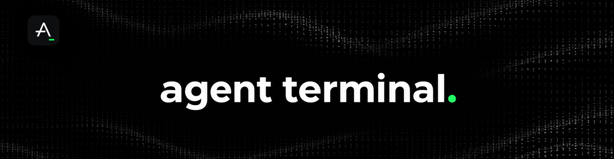
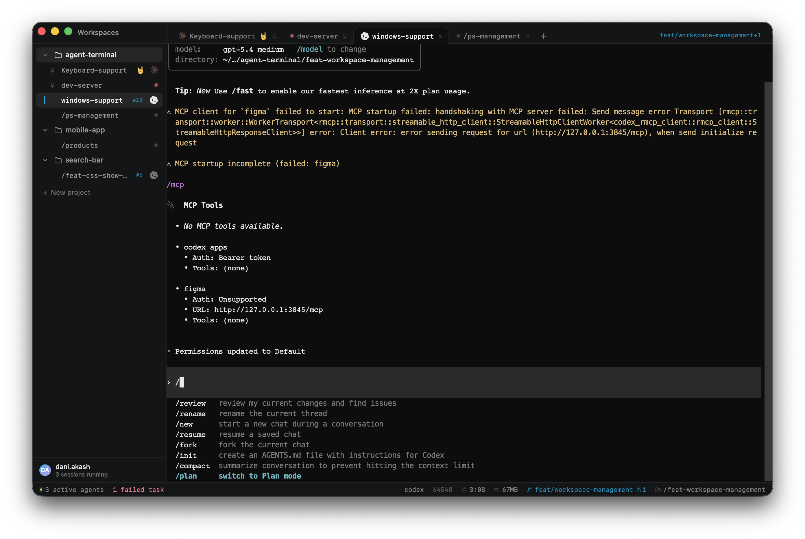

  

  # Agent Terminal

  **A terminal workspace built around AI coding agents.**

  
  
  

  
  
  
  

  
  &nbsp;
  

  <em>or install via Homebrew:</em> 
  <code>brew install --cask daniakash/tap/agent-terminal</code>

  Also available: <a href="https://github.com/DaniAkash/agent-terminal/releases/latest/download/agent-terminal-x64.dmg">Intel Mac</a>, and Linux <a href="https://github.com/DaniAkash/agent-terminal/releases/latest/download/agent-terminal-amd64.deb"><code>.deb</code></a> and <a href="https://github.com/DaniAkash/agent-terminal/releases/latest/download/agent-terminal-x86_64.rpm"><code>.rpm</code></a> packages.

  

---

## Status

> ✅ **Stable on macOS + Zsh.** Daily-driven, safe to install, and used every day. See the platform matrix below for other shells and operating systems.

## Why this exists

If you live in a terminal alongside [Claude Code](https://claude.ai/code), [Codex](https://github.com/openai/codex), or other AI coding agents, you've probably noticed normal terminals weren't designed for the way you work now: **multiple agents, multiple projects, multiple long-lived sessions, all needing context at a glance**.

Agent Terminal is a terminal that knows the difference between a shell and an agent. It groups your tabs by project, recognises when an agent is running, and surfaces what's happening — the model in use, what's listening on which port, the git branch, your cwd — without you switching windows or running `ps`.

---

## What you actually get

### Projects and tabs that survive
Group tabs under projects (`my-app`, `notes`, `infra`). Switch projects without losing your place — every tab remembers its working directory and reopens there.

### Agent Usage limits

Open **Agent Usage limits** in the status bar to enable provider quota tracking,
see reset windows, and configure usage collection. Hover for compact provider
gauges. Collection and settings are managed in Rust. See the
[Agent Usage limits guide](docs/agent-usage.md) for supported sources and local
session setup.

### Live status bar

Always-on context for the focused tab — refreshed every couple of seconds, never gets stale:

- Process name, PID, elapsed time, memory
- Listening TCP ports (so you know when your dev server is up)
- Git branch, dirty indicator, ahead/behind remote
- Working directory (hover for full path)

### Theme-aware workspace
 Switch between light, dark, and system themes from the status bar. The chosen theme now applies across the whole application and the active terminal, so agent sessions stay readable in both light and dark modes.

### Supported agents

| Agent | Status |
|---|---|
| [Claude Code](https://claude.ai/code) | ✅ Supported |
| [Codex CLI](https://github.com/openai/codex) | ✅ Supported |
| [opencode](https://github.com/sst/opencode) | ✅ Supported |
| [Amp](https://ampcode.com) | 🧪 Experimental |
| [Kilo Code](https://kilo.ai) | 🧪 Experimental |
| [Kimi CLI](https://www.kimi.com) | 🧪 Experimental |
| [Mastra](https://mastra.ai) | 🧪 Experimental |
| [Cursor](https://www.cursor.com) | 🔜 Planned |
| [GitHub Copilot CLI](https://github.com/features/copilot) | 🔜 Planned |
| [Factory Droid](https://factory.ai) | 🔜 Planned |
| [Qoder](https://qoder.com) | 🔜 Planned |

**Status key:** ✅ Supported = primary, well tested. 🧪 Experimental = detection works, still being tested. 🔜 Planned = coming soon.

Want support for another agent? [Open an issue](https://github.com/DaniAkash/agent-terminal/issues/new) or [tell me on X](https://x.com/dani_akash_).

### Find your way back
`Cmd+P` opens a switcher for your recently used tabs — type a few letters, hit Enter, you're there.

### Keyboard shortcuts
- `Ctrl+T` — new tab in the active project
- `Ctrl+W` — close the active tab
- `Ctrl+Tab` / `Ctrl+Shift+Tab` — cycle tabs
- `Ctrl+1` … `Ctrl+9` — jump to project N
- `Cmd+P` — open the recent-tabs quick-switcher

---

## Tested on

| Platform | Status |
|---|---|
| macOS 13+ (Apple Silicon / Intel) | ✅ Daily driver |
| Zsh | ✅ Daily driver |
| Bash | ⚠️ Should work, lightly tested |
| Fish | ⚠️ Should work, lightly tested |
| Linux (x86-64) | 🚧 Experimental — AppImage, Debian and RPM builds |
| Windows | 🚧 Untested — contributors wanted |

## 🙏 Looking for contributors

The most useful thing you can do right now is **help bring Agent Terminal to Windows and Linux**. The Tauri + portable-pty stack underneath supports both, but I don't run those platforms day-to-day, so the integration work isn't happening on its own.

Specifically helpful:

- **Linux testers** — try a dev build, file what's broken (rendering, shell integration, keyboard shortcuts, anything).
- **Windows testers + developers** — Windows needs ConPTY-side adjustments and a separate shell-integration path; if you're up for Tauri/Rust work, this is the highest-leverage area to contribute.
- **Other agent integrations** — adding Cursor and other agents is a focused PR (see [CONTRIBUTING.md](./CONTRIBUTING.md) for the agent registry guide).
- **Bug reports + feature ideas** — open an issue, even rough ones.

If you're interested, [open an issue](https://github.com/DaniAkash/agent-terminal/issues/new) or [reach out on X](https://x.com/dani_akash_) — happy to pair / sync on direction.

---

## Roadmap

Already shipped:
- ✅ Project-scoped workspaces with persistent tabs
- ✅ Live status bar (process, git, cwd, ports, model)
- ✅ Claude Code, Codex, and opencode detection and agent badges
- ✅ Agent turn detection (idle / in-progress / awaiting / done)
- ✅ Keyboard shortcuts
- ✅ Universal macOS binary (Apple Silicon + Intel)
- ✅ Theme toggle with light / dark / system support

Coming next:
- 🚧 More agent integrations (Cursor, and more)
- 🚧 Linux support
- 🚧 Windows support
- 🚧 macOS App Store distribution

---

## Contributing

For development setup, project structure, code conventions, and the MOD-system guide for adding new agents:

→ **[CONTRIBUTING.md](./CONTRIBUTING.md)**

---

## License

MIT — see [LICENSE](./LICENSE).

Copyright © 2026 [Dani Akash](https://github.com/DaniAkash). If you build on this project, please retain the copyright notice as required by the MIT License.
